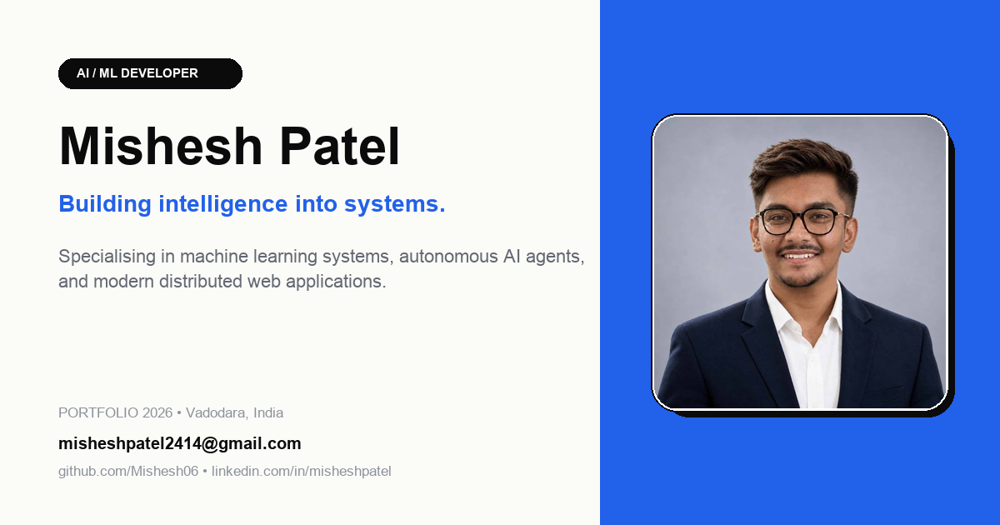

<div align="center">

# Mishesh Patel — Interactive Developer Portfolio

<p align="center">
  <strong>AI / ML Engineer & Full-Stack Developer</strong><br>
  Building intelligence into systems · Practical, intelligent, and scalable applications
</p>

[](https://misheshpatel.vercel.app)
[](https://www.linkedin.com/in/mishesh-patel)
[](https://github.com/Mishesh06)
[](mailto:misheshpatel2414@gmail.com)

<br/>



</div>

---

## ⚡ Overview

A performance-focused, Swiss editorial-style interactive developer portfolio inspired by clean architectural grids, tactile micro-interactions, and high-impact case studies.

- 🌐 **Live Website**: [https://misheshpatel.vercel.app](https://misheshpatel.vercel.app)
- 📄 **Resume**: Available directly on the site or at [`/Mishesh_Patel_Resume.pdf`](./public/Mishesh_Patel_Resume.pdf)

---

## 🛠️ Tech Stack

- **Framework**: [React 19](https://react.dev/) + [TypeScript](https://www.typescriptlang.org/)
- **Bundler & Build Tool**: [Vite](https://vitejs.dev/)
- **Styling**: [Tailwind CSS v4](https://tailwindcss.com/)
- **Icons**: [Lucide React](https://lucide.dev/)
- **Audio & Interactions**: Web Audio API (tactile mechanical clicks & sound design)
- **Deployment**: [Vercel](https://vercel.com/) with native SPA client-side routing

---

## 🚀 Featured Projects

| Project | Description | Tech Stack |
| :--- | :--- | :--- |
| **[Career Gap Analyzer](https://misheshpatel.vercel.app/work/career-gap-analyzer)** | AI-assisted diagnosis & personalized reskilling path builder. | Python, PyTorch, FastAPI, React |
| **[Branded Shortlink & Bio Hub](https://misheshpatel.vercel.app/work/branded-shortlink-bio-hub)** | High-throughput analytics engine & custom link routing platform. | TypeScript, Redis, Node.js, Next.js |
| **[Mini ERP & CRM Portal](https://misheshpatel.vercel.app/work/mini-erp-crm-portal)** | Multi-tenant operational command center with real-time sync. | React, PostgreSQL, Docker, Tailwind |

---

## ✨ Key Features

- **Architectural Swiss Layout**: Responsive subgrids, clean typography, and high-contrast editorial hierarchy.
- **Interactive Guide Companion**: Playful on-screen guide companion with real-time physics and state reactions.
- **Sound Design**: Toggleable tactile audio feedback powered by the browser's native Web Audio API synthesized frequencies.
- **Deep Case Studies**: Dedicated sub-pages (`/work/:slug`) with device previews, technical breakdowns, architecture overviews, and video reels.
- **Full Theme Support**: Light / Dark mode toggle with persisted preference.

---

## 💻 Local Development

To run this portfolio locally on your machine:

1. **Clone the repository:**
   ```bash
   git clone https://github.com/Mishesh06/MisheshPatel.git
   cd MisheshPatel
   ```

2. **Install dependencies:**
   ```bash
   npm install
   ```

3. **Start the local development server:**
   ```bash
   npm run dev
   ```

4. **Build for production:**
   ```bash
   npm run build
   ```

---

## 📬 Contact & Connect

- **Portfolio**: [https://misheshpatel.vercel.app](https://misheshpatel.vercel.app)
- **Email**: [misheshpatel2414@gmail.com](mailto:misheshpatel2414@gmail.com)
- **LinkedIn**: [linkedin.com/in/mishesh-patel](https://www.linkedin.com/in/mishesh-patel)
- **GitHub**: [github.com/Mishesh06](https://github.com/Mishesh06)

